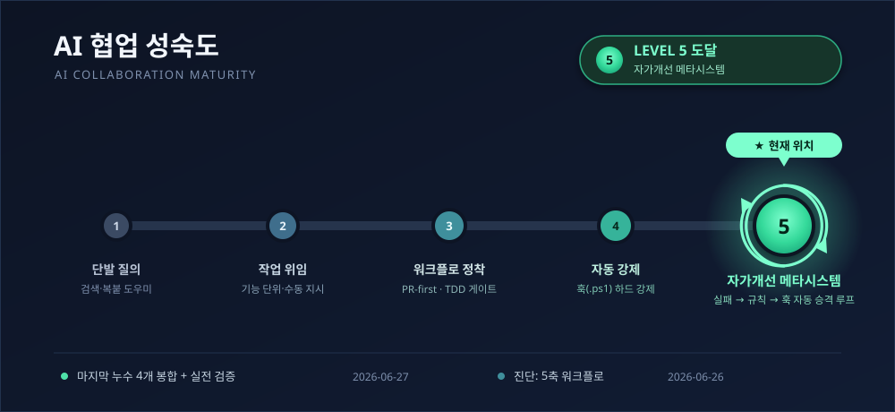

# BookTimer 📚⏱️

> 매일 일정 시간 책을 읽도록 독려하고 기록하는 **독서 타이머** 웹 애플리케이션
>
> 🌐 **Live**: https://booktimer.app

<p align="center">
  
</p>

---

## 1. 프로젝트 개요

BookTimer는 사용자가 하루에 일정 시간 책을 읽도록 **독려**하고 그 기록을 **누적**하는 서비스다.

단순한 스톱워치가 아니라, **읽지 않은 날의 부채가 날짜별로 쌓여 기한 없이 남는** 타이머 메커니즘을 통해 "오늘 안 읽으면 내일 더 읽어야 한다"는 부담을 만들어 꾸준한 독서 습관을 유도한다. 빚은 기다린다고 사라지지 않는다 — **목표보다 더 읽어 갚거나, 리워드 광고로 하루씩 지울 때만** 줄어든다(2026-08-14부터. 그 전의 「7일 지나면 자동 용서」는 폐지했다).

**웹을 우선**으로 구현했고, 모바일은 **앱인토스(토스 미니앱) 채널로 출시**했다(2026-08-11). 웹이 본진이다. 미니앱은 **2026-10-17부터 동결**(고장·보안·토스 정책 대응만 한다)이고, 새 모바일 기능은 **네이티브 앱 「책생글」**(iOS 먼저, 개발 중)에만 만든다 — 토스 미니앱이 막는 위젯·잠금화면 타이머·실시간 카메라·외부 연결을 쓰기 위해서다.

**현재 상태**: 핵심 기능 구현·배포·운영 중. 누적 타이머 + 인증(아이디·소셜) + 책 단위 기록·책장 + 일자별 기록·잔디 + 소셜(공개 프로필·검색·팔로우·차단·신고) + 책BTI(독서 성향 분석) + 공부 모드(공부 타이머·공부 서재·필기·백지복습) + 제휴 구매 링크 + 운영자 대시보드까지 출하했다. HTTPS·Google 소셜 로그인·무중단(blue-green) 배포 운영 중. **앱인토스 미니앱**(4탭: 홈·서재·책방·기록 + 리워드 광고 "밀린 하루 지우개")은 토스 앱 검색으로 계속 열리지만 동결 상태다. **책생글**은 서버 쪽 앱 로그인(Sign in with Apple · 웹 계정 연결)이 들어갔고, 앱 본체는 TestFlight 시험 단계다(첫 빌드 2026-10-21).

---

## 2. 핵심 기능

### 2.1 누적 증가 타이머 (핵심)

- 기본 기능은 **타이머**다.
- 매일 **하루 목표**만큼 읽어야 한다. (기본 1시간, **사용자 설정 가능**)
- 그날 채우지 못한 시간은 **부채**로 날짜별로 독립 집계되고, **기한 없이 누적**된다. (2026-08-14 전에는 7일이 지난 빚을 자동 용서했다 — 폐지.)
- 부채가 줄어드는 길은 **둘뿐**이다.
  - **더 읽어 갚기** — 어느 날이든 목표를 넘겨 읽으면 그 초과분이 **자기보다 오래된 빚부터** 갚는다(backward-only catch-up — 미리 읽어 두는 선납은 안 된다). 빠뜨린 날을 수동 입력으로 채우는 것도 그 날 읽은 양을 늘리는 것이라 같은 길이다(§2.4).
  - **리워드 광고 용서**("밀린 하루 지우개", 토스 미니앱) — 광고 1회 시청에 과거 하루의 남은 빚을 지운다. 횟수 제한은 없고, 지울 날은 서버가 고른다(남은 빚이 가장 큰 날). **오늘 몫은 광고로 지울 수 없다.**
- 부채를 세는 창은 `max(부채 누적 시작일, 첫 목표일)`부터 오늘까지이고, 매일 하루씩 자란다. 누적 시작일 하한(`booktimer.debt.epoch` = 2026-08-07)은 전환 순간 옛 사용자에게 가입 이후의 빚이 한꺼번에 살아나지 않게 막는 장치다. 목표 이력이 없는 레거시 계정만 옛 7일 창을 쓴다.

#### 동작 예시 (하루 목표 = 1시간 가정)

| 일자 | 하루 목표 | 그날 읽음 | 그날 부채 | 3일차 끝 남은 빚 |
|---|---|---|---|---|
| 1일차 | 1시간 | 30분 | 30분 | **0분** (3일차 초과분 30분으로 상환) |
| 2일차 | 1시간 | 0분 | 1시간 | **30분** (남은 초과분 30분으로 일부 상환) |
| 3일차(오늘) | 1시간 | 2시간 | 0분 (1시간 초과) | **0분** |

> 매일 목표만큼 부채가 생기고, 읽은 만큼 그날 부채가 준다. 초과분은 가장 오래된 빚부터 갚는다. 2일차에 남은 30분은 기다려도 사라지지 않는다 — 더 읽어 갚거나 광고로 그 날을 지운다.

### 2.2 인증 / 식별 모델

식별·인증·표시 역할을 **세 값으로 분리**한다 (인스타·X의 @handle 모델).

| 값 | 역할 | 공개 | 가변 |
|---|---|---|---|
| **로그인 아이디 (`login_id`)** | 로그인 + 내부 식별 + **공개 @핸들**(검색·프로필 URL) | 공개 | **평생 1회 변경** |
| **닉네임 (nickname)** | 화면 표시 이름 | 공개 | 자유 변경 (중복 허용) |
| **이메일 (email)** | 연락·복구·OAuth 계정 연결 | **비공개** | (정책 별도) |

- **로그인은 아이디(login_id)로** 한다 — 공개된 이메일을 로그인 표적에서 분리한 보안 결정. 이메일로는 로그인할 수 없다.
- **Google 소셜 로그인**(OIDC) — `email_verified`만 신뢰하는 find-or-create 프로비저닝. 소셜 계정은 비밀번호가 없어 관련 UX를 분기.
- **앱 채널 로그인** — 토스 미니앱은 토스 로그인, 책생글 앱은 Sign in with Apple로 Bearer 토큰을 받아 같은 `/api/**`를 부른다. 기존 웹 계정과 연결할 수 있다.
- **온보딩** — 첫 진입 시 아이디(소셜 가입자)·표시 이름·타이머 초기값을 한 번에 설정.
- 계정 보안: 비밀번호 변경 / 회원 탈퇴, 로그인 무차별 대입 방어(IP 잠금).
- 설계: [claude-docs/login-id-design.md](claude-docs/login-id-design.md)

### 2.3 책 단위 기록 / 책장

- **책 등록** + 책별 누적 독서 시간 추적. **책 없이도 측정할 수 있고**, 책은 종료 직후 창 또는 기록 화면(측정 한 건 단위)에서 붙이고·바꾸고·뗀다(`POST /api/sessions/{id}/book`). 수동 기록만 책 필수.
- 외부 도서 검색(알라딘 API) 연동 — 제목으로 검색해 등록.
- **책장 상태**: 읽고싶음 / 읽는 중 / 완독. 책별 **공개 여부**(PUBLIC/PRIVATE) 설정.
- 책 상세·책장·공개 책방에서 **제휴(어필리에이트) 구매 링크** 제공(클릭 추적) — **알라딘 + 쿠팡 파트너스 병행**(쿠팡은 추적코드 설정 시 노출, 파트너별 클릭 분리 집계).

### 2.4 독서 기록 / 잔디

- 일자별 독서 시간 측정·저장, 누적 / 부채 추적.
- 그날 **읽은 책 제목**과 총 시간을 일자별로 표시. 날짜를 펼치면 **측정 한 건씩**(시각 범위 · 길이 · 책) 보이고, 그 줄에서 책을 붙이거나 바꾼다(공부 기록도 같다).
- **잔디(기여 그래프)** — 날짜별 독서량을 시각화(하루 목표 대비 비율로 색 농도 결정). 공개 프로필에 노출.
- **연속 일수** — 오늘까지 며칠 연속 읽었는지. 기록 화면 스탯 줄에 적는다(성장 식물 사다리는 2026-08-29 폐기).
- **수동 입력** — 빠뜨린 기록을 나중에 추가(빠뜨린 날 목록의 「채우기」 링크). 입력할 수 있는 날짜의 하한은 **부채 창 시작일과 같다** — 부채로 세는 날은 모두 채울 수 있다. 수동 입력 날은 잔디에서 앰버 테두리로 구분.

### 2.6 소셜 (SNS)

- **공개 프로필** `/u/{login_id}` — 잔디·공개 책장 등.
- **사용자 검색** — 아이디(@핸들) 기준.
- **팔로우 / 언팔로우**, **차단(block)**, **신고(report)**(쓰기 남용 방지 rate limiting).
- **팔로우 범위 인기 카운트 + drill-down** — "그 책을 원함/읽음인 내 팔로우 명단"을 같은 게이트(팔로우·PUBLIC·distinct)로 펼침(새 노출 0, IDOR 없음).
- 공개범위·관계·IDOR·스키마 설계: [claude-docs/sns-design.md](claude-docs/sns-design.md)

### 2.7 운영자 대시보드

- `/admin` (ROLE_ADMIN 전용) — ENV 시드(`BOOKTIMER_ADMIN_LOGIN_IDS`)로 부트스트랩 승격.
- **운영 통계 요약** — 가입자 수·온보딩 완료·최근 7일 활성·총 책/세션·평균 독서 시간(읽기 전용 집계).
- **데이터 조회** — 사용자 목록(검색·페이징) + 드릴다운(타이머 설정·최근 세션·책장 요약). **PII 최소 노출**(비밀번호 해시 미전송, 이메일 마스킹).
- 운영자는 검색·공개 프로필에서 숨겨져 일반 사용자 동선과 분리.
- 설계: [claude-docs/admin-data-lookup-design.md](claude-docs/admin-data-lookup-design.md)

### 2.8 책BTI(독서 성향 분석) · 구독(구상)

- **책BTI — 책장 기반 독서 성향 분석**(`/personality`, 2026-06-07~) — 사실 집계는 코드, 해석·서술만 LLM. 결정적 성향 태그는 책방(공개 프로필)에 노출된다. 설계: [claude-docs/reading-personality-design.md](claude-docs/reading-personality-design.md)
- 성향·추천·채팅을 묶은 **월 정액 구독**은 아직 구상 단계다(plan.md). **구현 전 설계 합의 필수.**

---

## 3. 기술 스택

| 영역 | 기술 | 비고 |
|---|---|---|
| **프론트엔드** | Thymeleaf (SSR) | 메인 UI 셸 |
| **프론트 섬** | Vue 3 + Vite + TypeScript | SSR 셸에 올리는 Vue 섬 번들(`frontend/`) |
| **토스 미니앱** | Vite + React 18 + TDS + `@apps-in-toss/web-framework` | 앱인토스 채널(`miniapp/`) — 서버 `/api/**`만 Bearer로 호출, 배포는 `ait` CLI(우리 CI 밖). **2026-10-17부터 동결** |
| **네이티브 앱 (개발 중)** | Expo / React Native + EAS | 「책생글」 — iOS 먼저. Sign in with Apple(`/api/app/**`) 뒤 기존 `/api/**`를 Bearer로 호출 |
| **백엔드** | Spring Boot 4.1.1 (Java 21) | 빌드 툴 Gradle (Groovy DSL) |
| **인증** | Spring Security | 아이디+비밀번호 자체 인증 + Google OAuth2/OIDC, 세션 외부화(JDBC). `/api/**`는 Bearer 토큰(토스·Apple 로그인) |
| **DB / 마이그레이션** | MySQL 8.4 + JPA(Hibernate), **Flyway** | 운영 MySQL, 테스트는 H2 인메모리. 스키마는 Flyway가 단일 소스 |
| **클라우드** | AWS (EC2 단일 인스턴스, Route 53, S3, SSM, ECR) | Docker Compose — Caddy(TLS · Let's Encrypt) + app-blue/app-green 무중단 전환 + MySQL 컨테이너, 일일 S3 백업. 2026-08-03 ECS Fargate·ALB·RDS에서 이전 |
| **CI/CD** | GitHub Actions | 빌드 / 테스트 / OIDC 키리스 배포(ECR 푸시 → SSM으로 EC2에서 blue-green 전환) |

---

## 4. 로드맵

- [x] **MVP** — 누적 증가 타이머(사용자 설정 하루 목표) + 일자별 독서 시간 기록
- [x] AWS + Docker 배포 파이프라인 (GitHub Actions, OIDC 키리스)
- [x] HTTPS 적용 (도메인 + ALB TLS termination → EC2 이전 뒤 Caddy)
- [x] 세션 외부화(Spring Session JDBC) + 무중단 롤링 배포 (EC2 이전 뒤 blue-green 전환)
- [x] OAuth 소셜 로그인 (Google)
- [x] **로그인 아이디(공개 @핸들) 도입** — 이메일을 로그인 식별자에서 분리
- [x] **책 단위 기록** — 책 등록(알라딘 검색) + 책별 누적 시간 + 책장 상태/공개여부
- [x] **잔디(기여 그래프)** + 일자별 읽은 책 표시 + 연속 일수
- [x] **소셜** — 공개 프로필·검색·팔로우·차단·신고·팔로우 범위 인기 drill-down
- [x] **제휴 구매 링크**(알라딘 + 쿠팡 파트너스 병행)
- [x] **운영자 대시보드** — 통계 요약 + 데이터 조회
- [x] **수동 독서 입력** — 빠뜨린 기록 사후 추가 (부채 창 안 — 처음엔 최근 7일)
- [x] **per-day 부채 모델** — 날짜별 독립 부채, 초과 읽기로 과거 빚 상환 (2026-06-07, 처음엔 7일 윈도우 + 자동 용서)
- [x] **부채 무제한 누적** — 7일 자동 소멸 폐지, 리워드 광고 용서(횟수 제한 없음, 오늘 몫 제외) (2026-08-14)
- [x] **ECS Fargate → EC2 단일 인스턴스 이전** — Caddy TLS + blue-green 무중단 전환, 월 원가 ~$100 → ~$30 (2026-08-03)
- [x] **책BTI(독서 성향 분석)** — 책장 기반 성향 + 책방에 노출되는 성향 태그 (2026-06-07 ~ 06-10)
- [x] **공부 모드** — 공부 타이머·공부 서재·필기·백지복습 (2026-09~)
- [x] **작가 격언** — 대시보드 랜덤 격언 노출 (DB 관리·운영자 추가 가능)
- [x] ~~**독서 마을**~~ — 수집형 게임화 레이어. **2026-09-09 전면 폐기**(배치 엔진·Phaser는 그 전에 은퇴)
- [x] **랜딩 페이지 리디자인** — 와이드 마케팅 랜딩
- [x] **앱인토스 미니앱 출시** — 토스 앱 검색 채널, 4탭(홈·서재·책방·기록) + 리워드 광고 "밀린 하루 지우개" (2026-08-11) · **2026-10-17부터 동결**
- [ ] **네이티브 앱 「책생글」 v1** — 읽기 → 건지기 → 쓰기 → 내보내기 한 루프, iOS 먼저 (2026-10-17 설계 승인 · 개발 중)
- [ ] 카카오/네이버 등 추가 provider (선택)
- [ ] 월 정액 구독 비즈니스 모델 (구상 단계, 구현 전 합의 필요)

---

## 5. 아키텍처

```
[ 사용자 브라우저 · 토스 미니앱(동결) · 책생글 앱(개발 중) ]
        │  HTTPS
        ▼
[ EC2 단일 인스턴스 — Docker Compose ]
  │
  ├─ Caddy  ── TLS termination (Let's Encrypt 자동 발급), HTTP→HTTPS·호스트 301
  │     │  HTTP (내부) — active health check로 살아 있는 쪽에만 보낸다
  │     ▼
  ├─ app-blue / app-green : Spring Boot   ── 배포 때 한쪽씩 교대(무중단)
  │     ├─ Thymeleaf 뷰 (SSR) + Vue 3 섬
  │     ├─ Spring Security (아이디/비밀번호 + Google OIDC, /api/** Bearer 토큰)
  │     └─ Spring Session (세션을 MySQL에 외부화 → 전환해도 로그인 유지)
  │     ▼
  │  [ JPA / Hibernate ]   ── 스키마는 Flyway 마이그레이션이 단일 소스
  │     ▼
  └─ MySQL 8.4  ── 일일 백업 → S3

도메인/DNS: Route 53 (booktimer.app → EIP)
CI/CD: GitHub Actions → Docker 이미지(ECR) → SSM Send-Command → EC2에서 blue-green 전환 → 라이브 헬스체크
```

> 인프라 상세는 `deploy/` 및 [claude-docs/deploy-ec2.md](claude-docs/deploy-ec2.md)(현행) 참고. 같은 인스턴스에 다른 미니앱 **facefit**의 API 서버가 함께 산다 — 자원·MySQL·Caddy 문제를 볼 땐 [claude-docs/facefit-tenant.md](claude-docs/facefit-tenant.md)부터.

---

## 6. 핵심 도메인 규칙 요약

| 규칙 | 결정 |
|---|---|
| **하루 목표(daily increment)** | 매일 읽어야 하는 양. **사용자 설정**, 기본 1시간 |
| **하루 부채(per-day debt)** | `max(0, 하루목표 − 그날 읽은 초)` — 날짜별로 독립 발생, 저장 안 하고 완료 세션에서 유도 |
| **부채 창(무제한 누적)** | 창 = `max(부채 누적 시작일, 첫 목표일)` ~ 오늘, 매일 하루씩 자란다(`ReadingDebtService.debtWindowStart`). **자동 용서 없음**(2026-08-14 폐지). 전환 하한 `booktimer.debt.epoch` = 2026-08-07. 목표 이력이 없는 레거시 계정만 옛 7일 창으로 폴백 |
| **backward-only catch-up** | 어느 날이든 목표 초과분 → **자기보다 오래된 빚부터** 상환 (선납 불가 — 어제 많이 읽어도 오늘 몫은 줄지 않는다) |
| **리워드 광고 용서** | 광고 1회 = 과거 하루의 남은 부채를 0으로. **횟수 제한 없음**, 대상 날짜는 서버가 고른다(남은 빚 최대, 동률이면 최신). **오늘 몫은 대상 아님**. 그 날의 초과분(상환 재원)은 건드리지 않는다. 토스 미니앱 전용(`/api/miniapp/debt-waiver`) |
| **1분 미만 용서** | 과거 날의 부채가 1분 미만이면 0 — 목표를 분 단위로 올린 뒤 남는 반올림 잔재 |
| **일일 리셋 시점** | **자정 00:00, 사용자 타임존 기준**. 이 시점에 새 하루 부채 발생 |
| **부채 계산 방식** | **저장하지 않고 매 조회마다 유도** — 완료 세션(유저 TZ 일자별 합)과 그날 유효 목표로 창 전체를 다시 계산. 누적 카운터·배치 스케줄러 없음 |
| **식별/인증 분리** | 로그인·식별·공개 핸들 = `login_id`(유니크 · 평생 1회 변경, 옛 핸들은 영구 예약), 표시 = nickname(가변·중복허용), 이메일 = 비공개 속성 |
| **책 라벨은 선택** | 세션이 시간의 원장이고 책은 그 라벨이다 — `book=null`은 1급 상태(잔디·부채엔 반영, 책별 통계에선 빠짐). 라벨은 종료 직후(`tag-book`)·측정 중(`active/book`)·끝난 기록 정정(`POST /api/sessions/{id}/book`, 자정 분할 조각은 함께)으로 고친다. 수동 기록만 책 필수 |
| **공개 경계** | 책 공개여부(PUBLIC/PRIVATE) + 차단 관계로 조회 주체를 게이트(IDOR 방지) |
| **타이머 신뢰성** | 부정 사용(켜두고 안 읽기) 검증 안 함. 자기 양심 기반 |

---

## 7. 부채 모델 계산 로직 (의사 코드)

부채를 보여 주는 응답(웹 대시보드 · `/api/dashboard` · 측정 시작/종료)마다 다시 계산한다:

```
// 창 시작 — ReadingDebtService.debtWindowStart
기준 = 첫_목표일 (목표 이력이 없으면 오늘-6 — 레거시 폴백)
창_시작 = max(기준, 부채_누적_시작일)            // booktimer.debt.epoch = 2026-08-07
창 = [창_시작 ~ 오늘] (사용자 타임존)            // 매일 하루씩 자란다 — 자동 소멸 없음

// 날짜별 원시 부채·초과분 — 여기부터 WeeklyDebtCalculator
for 날짜 in 창:
    그날_목표 = GoalSchedule.goalFor(날짜)       // 그날 유효 목표(변경 이력 기반)
    그날_읽은_초 = 완료 세션 합계(날짜, 사용자TZ)
    부채[날짜] = max(0, 그날_목표 − 그날_읽은_초)
    초과[날짜] = max(0, 그날_읽은_초 − 그날_목표)
    if 날짜 != 오늘:
        if 부채[날짜] < 60초:          부채[날짜] = 0   // 목표 인상 반올림 잔재
        if 날짜 in 광고로_용서한_날:   부채[날짜] = 0   // 초과[날짜]는 그대로 둔다

// backward-only 재분배: 오래된 빚부터, 그보다 나중 날의 초과분으로 (선납 불가)
for 빚진_날 in 창 − {오늘} (오래된 순):
    for 갚는_날 in (빚진_날+1 ~ 오늘) (이른 순):
        상환 = min(초과[갚는_날], 부채[빚진_날])
        부채[빚진_날] -= 상환
        초과[갚는_날] -= 상환

총_부채 = sum(부채.values())
```

> 핵심: 날짜별 독립 부채, **기한 없이 누적**, 초과 읽기와 광고 용서로만 준다. `GoalSchedule`로 목표 변경 전 날짜를 소급 오염 없이 판정(per-day 목표 스냅샷). 창을 정하는 곳은 `ReadingDebtService`, 계산기 `WeeklyDebtCalculator`는 넘겨받은 목표 맵의 범위만 계산한다(이름의 「Weekly」는 옛 7일 창의 흔적).

---

## 8. 빌드 / 실행

```bash
./gradlew build          # 빌드 (Windows: gradlew.bat)
./gradlew test           # 테스트 (H2 인메모리 + Vitest — Docker 불필요)
./gradlew bootRun        # 로컬 실행 (MySQL은 compose.yaml로 자동 기동, Docker 필요)
npm --prefix frontend run test:e2e   # E2E (Playwright; 별도 터미널에서 bootRun이 8080에 떠 있는 상태)
```

- toolchain: Java 21 (로컬에 없어도 foojay-resolver 가 자동 다운로드)
- 테스트는 H2 인메모리로 독립 실행되며, 운영은 MySQL을 사용한다. 스키마는 **Flyway** 마이그레이션이 단일 소스(`src/main/resources/db/migration`).
- 실행 시 Spring Security가 전 엔드포인트를 기본 잠금 — 가입/로그인 후 사용.
- **프론트 섬 번들**(`src/main/resources/static/<앱>/<앱>.js`)은 커밋되어 있어 별도 빌드 불필요. TypeScript 소스(`frontend/`) 수정 시: `npm --prefix frontend run build`.
- **E2E(Playwright)**는 로컬 수동 — 별도 터미널에서 `bootRun`(시드계정 `testid`)을 띄운 뒤 `npm --prefix frontend run test:e2e`. 테스트는 `frontend/e2e/`(로그인). 커밋 게이트·CI엔 미포함(CI는 vitest·JUnit만).

---

## 9. 결정 보류 / 추후 확정 필요

- 아이디(login_id)·이메일 변경 정책(허용 여부·쿨다운)
- 독서 성향 분석의 분석 축·프라이버시·AI 모델, 구독 가격 가설 검증
- 추가 소셜 provider(카카오/네이버) 도입 여부

---

## 10. 관련 문서

- [DEVLOG.md](DEVLOG.md) — 개발 일지 (기능 추가 흐름 / 만난 문제 / 해결)
- [plan.md](plan.md) — 추후 할 일 / 로드맵 / 기술 부채
- [claude-docs/changelog.md](claude-docs/changelog.md) — 갱신 이력(변경 일지)
- [claude-docs/code-map.md](claude-docs/code-map.md) — **기능별 코드 지도** (기능 작업 전 진입점·소속 파일 직행용 참조)
- [miniapp/README.md](miniapp/README.md) — 토스 미니앱(앱인토스) 프론트 — 화면 구성·개발·`ait` 배포 절차
- [claude-docs/domain-design.md](claude-docs/domain-design.md) — 도메인 모델 설계
- [claude-docs/login-id-design.md](claude-docs/login-id-design.md) — 로그인 아이디(식별/인증 분리) 설계
- [claude-docs/sns-design.md](claude-docs/sns-design.md) — 소셜(공개범위·관계·IDOR·스키마) 설계
- [claude-docs/admin-data-lookup-design.md](claude-docs/admin-data-lookup-design.md) — 운영자 데이터 조회 설계
- [claude-docs/reading-personality-design.md](claude-docs/reading-personality-design.md) — 책BTI(독서 성향 분석) 설계
- [claude-docs/deploy-ec2.md](claude-docs/deploy-ec2.md) — AWS 배포 가이드 (현행 — EC2 단일 인스턴스)
- [claude-docs/deploy-aws.md](claude-docs/deploy-aws.md) — 구 아키텍처(ECS Fargate + ALB + RDS) 배포 가이드 (역사 — SSM·SES 설정은 아직 유효)
- [claude-docs/learning-notes.md](claude-docs/learning-notes.md) — 작업 중 배운 개념 정리 (**아카이브** — 2026-08-18 폐기, 새 항목 추가 안 함)
- [claude-docs/troubleshooting.md](claude-docs/troubleshooting.md) — 함정·해결 기록
- [claude-docs/copyright-registration.md](claude-docs/copyright-registration.md) — 한국 저작권 등록 가이드
